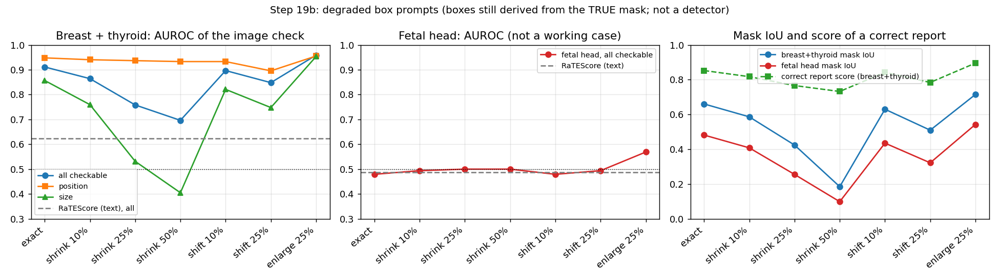

# Step 19b — Box-degradation sweep for the image check (oracle dependence)

**This is a degraded-prompt sweep, NOT a detector.** Every box is still derived from the TRUE mask (then shrunk, shifted or enlarged), so it does not replace an end-to-end test where a model finds the lesion itself. Setup is Step 16 exactly: MedSAM (`wanglab/medsam-vit-base`, MPS), the same 288 test scans (30 per dataset, 18 BUS-UCLM; at most 3 per group), the same `mask_verified_facts` check, the same reports (`bench_v2d`), planted size errors ×0.5 to ×2. Conditions (seed 0): exact box (cached Step 16 masks), shrink 10/25/50% about its centre, shift 10/25% of box size in a random direction, enlarge 25%. 1,728 new masks (44 min, cached in `local_data/partb_sweep`, git-ignored). Code: `usmeta/step19_boxsweep.py`. Plot: `boxsweep.png`.

**Sanity (exact box reproduces Step 16):** breast + thyroid AUROC all checkable 0.91 (0.89–0.93), position 0.95 (0.92–0.97), size 0.86 (0.82–0.89); correct-report mean 0.852 (Step 16 / Step 20 exact-match row: 0.91, 0.95, 0.86, 0.852). Match.

## Headline (breast + thyroid pooled, n = 228 scans; fetal head separate)
| condition | mask IoU (n=198) | AUROC all checkable | position errors | size errors | correct report scores | share scoring 1.0 |
|---|---|---|---|---|---|---|
| exact | 0.66 (0.63–0.69) | 0.91 (0.89–0.93) | 0.95 (0.92–0.97) | 0.86 (0.82–0.89) | 0.852 | 0.07 |
| shrink 10% | 0.59 (0.56–0.61) | 0.86 (0.84–0.89) | 0.94 (0.91–0.97) | 0.76 (0.72–0.80) | 0.817 | 0.02 |
| shrink 25% | 0.42 (0.40–0.45) | 0.76 (0.74–0.78) | 0.94 (0.91–0.96) | 0.53 (0.50–0.57) | 0.766 | 0.01 |
| shrink 50% | 0.18 (0.17–0.20) | 0.70 (0.69–0.71) | 0.93 (0.90–0.96) | 0.40 (0.39–0.42) | 0.732 | 0.00 |
| shift 10% | 0.63 (0.60–0.66) | 0.90 (0.88–0.91) | 0.93 (0.90–0.96) | 0.82 (0.79–0.85) | 0.843 | 0.07 |
| shift 25% | 0.51 (0.48–0.54) | 0.85 (0.83–0.87) | 0.90 (0.86–0.93) | 0.75 (0.71–0.79) | 0.784 | 0.02 |
| enlarge 25% | 0.71 (0.69–0.74) | 0.96 (0.95–0.97) | 0.96 (0.93–0.98) | 0.95 (0.93–0.97) | 0.895 | 0.12 |

Text scorer RaTEScore on the same cases (no image, independent of the box): all checkable 0.62 (0.61–0.63), position 0.28 (0.27–0.30), size 0.52 (0.49–0.54).

- **Position errors are robust, size errors are not.** Position AUROC stays 0.93–0.96 except shift 25% (0.90); size AUROC falls from 0.86 (exact) to 0.76 (shrink 10%), 0.53 (shrink 25%) and 0.40 (shrink 50%, **below chance**; not tested why, but a too-small box gives a too-small measured lesion, which could make some planted "too large" sizes look right).
- **The image check beats the text scorer (RaTEScore, all checkable 0.62) in every condition tested on all checkable errors, but on size errors only down to shrink 10%** (RaTEScore size 0.52); at shrink 25% and 50% it is no better than, or worse than, the text scorer.
- **Shifted boxes cost little** (shift 10%: all 0.90; shift 25%: 0.85). **A 25% larger box is better than the exact box** (all 0.96, size 0.95, IoU 0.71): IoU is also higher, consistent with a tight box under-segmenting (not tested), so Step 16's numbers are not an upper bound on prompt quality.
- **Correct reports are marked down more as the box worsens:** 0.852 (exact) → 0.766 (shrink 25%) → 0.732 (shrink 50%); the share scoring a full 1.0 is 0.12 at best (enlarge 25%) and 0.07 with the exact box.
- **Fetal head** (separate, 60 scans): AUROC 0.48 with the exact box and 0.50–0.57 across all conditions (RaTEScore 0.49); no box degradation changes the conclusion that this check does not work on fetal head (annotation mismatch, Step 16).
- **Reading:** the Step 16 result (0.91) depends on a good box for size claims, and a mildly generous box is better than a tight one; a real lesion detector would have to be at least as good as a box 10% too small (size AUROC 0.76) to keep a size advantage over text. Position claims tolerate rough boxes.

## Per dataset (test; † n < 30 scans: too small to compare)
| dataset | condition | n | mask IoU (TN5000: box IoU) | AUROC all checkable | position errors | size errors | correct report scores | RaTEScore all |
|---|---|---|---|---|---|---|---|---|
| BrEaST | exact | 30 | 0.74 (0.68–0.79) | 0.93 (0.88–0.97) | 0.97 (0.91–1.00) | 0.88 (0.78–0.96) | 0.894 | 0.64 (0.62–0.65) |
| BrEaST | shrink 10% | 30 | 0.67 (0.62–0.73) | 0.92 (0.87–0.96) | 0.97 (0.91–1.00) | 0.87 (0.78–0.95) | 0.855 | 0.64 (0.62–0.65) |
| BrEaST | shrink 25% | 30 | 0.50 (0.45–0.56) | 0.80 (0.75–0.86) | 1.00 (1.00–1.00) | 0.62 (0.52–0.71) | 0.808 | 0.64 (0.62–0.65) |
| BrEaST | shrink 50% | 30 | 0.22 (0.20–0.25) | 0.68 (0.65–0.71) | 0.94 (0.85–1.00) | 0.37 (0.34–0.39) | 0.740 | 0.64 (0.62–0.65) |
| BrEaST | shift 10% | 30 | 0.71 (0.66–0.76) | 0.93 (0.89–0.97) | 1.00 (1.00–1.00) | 0.88 (0.79–0.96) | 0.889 | 0.64 (0.62–0.65) |
| BrEaST | shift 25% | 30 | 0.59 (0.53–0.65) | 0.89 (0.84–0.94) | 0.97 (0.91–1.00) | 0.85 (0.76–0.93) | 0.830 | 0.64 (0.62–0.65) |
| BrEaST | enlarge 25% | 30 | 0.72 (0.66–0.77) | 0.97 (0.94–0.99) | 0.94 (0.85–1.00) | 0.97 (0.92–1.00) | 0.908 | 0.64 (0.62–0.65) |
| BUS-BRA | exact | 30 | 0.61 (0.56–0.66) | 0.91 (0.86–0.95) | 0.94 (0.85–1.00) | 0.83 (0.73–0.91) | 0.865 | 0.64 (0.63–0.66) |
| BUS-BRA | shrink 10% | 30 | 0.53 (0.48–0.59) | 0.83 (0.78–0.88) | 0.94 (0.86–1.00) | 0.66 (0.56–0.78) | 0.830 | 0.64 (0.63–0.66) |
| BUS-BRA | shrink 25% | 30 | 0.37 (0.33–0.42) | 0.72 (0.69–0.75) | 0.97 (0.90–1.00) | 0.40 (0.35–0.46) | 0.786 | 0.64 (0.63–0.66) |
| BUS-BRA | shrink 50% | 30 | 0.17 (0.14–0.19) | 0.71 (0.70–0.73) | 0.94 (0.84–1.00) | 0.39 (0.36–0.42) | 0.773 | 0.64 (0.63–0.66) |
| BUS-BRA | shift 10% | 30 | 0.59 (0.53–0.65) | 0.87 (0.83–0.92) | 0.94 (0.85–1.00) | 0.75 (0.65–0.84) | 0.848 | 0.64 (0.63–0.66) |
| BUS-BRA | shift 25% | 30 | 0.51 (0.46–0.56) | 0.87 (0.82–0.91) | 0.97 (0.90–1.00) | 0.75 (0.67–0.83) | 0.827 | 0.64 (0.63–0.66) |
| BUS-BRA | enlarge 25% | 30 | 0.70 (0.64–0.76) | 0.97 (0.93–1.00) | 0.97 (0.90–1.00) | 0.96 (0.89–1.00) | 0.921 | 0.64 (0.63–0.66) |
| BUSI | exact | 30 | 0.73 (0.68–0.77) | 0.95 (0.91–0.98) | 0.92 (0.84–1.00) | 0.93 (0.84–1.00) | 0.894 | 0.70 (0.67–0.71) |
| BUSI | shrink 10% | 30 | 0.66 (0.61–0.72) | 0.92 (0.88–0.96) | 0.89 (0.79–0.97) | 0.88 (0.77–0.95) | 0.857 | 0.70 (0.67–0.71) |
| BUSI | shrink 25% | 30 | 0.50 (0.45–0.55) | 0.78 (0.73–0.84) | 0.92 (0.82–1.00) | 0.58 (0.49–0.68) | 0.779 | 0.70 (0.67–0.71) |
| BUSI | shrink 50% | 30 | 0.22 (0.19–0.25) | 0.70 (0.69–0.72) | 0.92 (0.82–1.00) | 0.37 (0.34–0.41) | 0.768 | 0.70 (0.67–0.71) |
| BUSI | shift 10% | 30 | 0.68 (0.62–0.74) | 0.94 (0.90–0.97) | 0.92 (0.84–1.00) | 0.89 (0.81–0.96) | 0.883 | 0.70 (0.67–0.71) |
| BUSI | shift 25% | 30 | 0.55 (0.48–0.62) | 0.88 (0.83–0.94) | 0.84 (0.74–0.95) | 0.81 (0.71–0.91) | 0.818 | 0.70 (0.67–0.71) |
| BUSI | enlarge 25% | 30 | 0.77 (0.74–0.80) | 0.96 (0.93–0.99) | 0.89 (0.79–0.97) | 0.96 (0.89–1.00) | 0.921 | 0.70 (0.67–0.71) |
| UDIAT | exact | 30 | 0.80 (0.77–0.84) | 0.98 (0.96–1.00) | 1.00 (1.00–1.00) | 0.98 (0.95–1.00) | 0.943 | 0.69 (0.67–0.70) |
| UDIAT | shrink 10% | 30 | 0.73 (0.69–0.77) | 0.97 (0.94–0.99) | 1.00 (1.00–1.00) | 0.94 (0.90–0.99) | 0.910 | 0.69 (0.67–0.70) |
| UDIAT | shrink 25% | 30 | 0.56 (0.51–0.61) | 0.86 (0.82–0.90) | 0.98 (0.93–1.00) | 0.69 (0.60–0.79) | 0.841 | 0.69 (0.67–0.70) |
| UDIAT | shrink 50% | 30 | 0.24 (0.21–0.28) | 0.72 (0.71–0.74) | 0.98 (0.93–1.00) | 0.38 (0.35–0.41) | 0.795 | 0.69 (0.67–0.70) |
| UDIAT | shift 10% | 30 | 0.79 (0.76–0.82) | 0.99 (0.97–1.00) | 1.00 (1.00–1.00) | 0.98 (0.95–1.00) | 0.942 | 0.69 (0.67–0.70) |
| UDIAT | shift 25% | 30 | 0.64 (0.60–0.68) | 0.90 (0.86–0.94) | 0.98 (0.93–1.00) | 0.79 (0.69–0.88) | 0.865 | 0.69 (0.67–0.70) |
| UDIAT | enlarge 25% | 30 | 0.82 (0.78–0.85) | 0.99 (0.98–1.00) | 1.00 (1.00–1.00) | 1.00 (1.00–1.00) | 0.957 | 0.69 (0.67–0.70) |
| BUS-UCLM † | exact | 18 | 0.66 (0.53–0.77) | 0.95 (0.87–0.99) | 1.00 (1.00–1.00) | 0.91 (0.76–1.00) | 0.871 | 0.69 (0.65–0.72) |
| BUS-UCLM † | shrink 10% | 18 | 0.58 (0.46–0.70) | 0.87 (0.79–0.93) | 1.00 (1.00–1.00) | 0.76 (0.61–0.89) | 0.821 | 0.69 (0.65–0.72) |
| BUS-UCLM † | shrink 25% | 18 | 0.40 (0.33–0.50) | 0.72 (0.63–0.81) | 0.94 (0.83–1.00) | 0.47 (0.33–0.62) | 0.739 | 0.69 (0.65–0.72) |
| BUS-UCLM † | shrink 50% | 18 | 0.17 (0.14–0.21) | 0.67 (0.64–0.70) | 0.94 (0.83–1.00) | 0.39 (0.35–0.43) | 0.722 | 0.69 (0.65–0.72) |
| BUS-UCLM † | shift 10% | 18 | 0.59 (0.49–0.71) | 0.88 (0.79–0.95) | 1.00 (1.00–1.00) | 0.76 (0.59–0.91) | 0.845 | 0.69 (0.65–0.72) |
| BUS-UCLM † | shift 25% | 18 | 0.48 (0.40–0.56) | 0.82 (0.73–0.90) | 0.88 (0.67–1.00) | 0.68 (0.55–0.80) | 0.761 | 0.69 (0.65–0.72) |
| BUS-UCLM † | enlarge 25% | 18 | 0.75 (0.64–0.85) | 0.97 (0.94–1.00) | 1.00 (1.00–1.00) | 0.94 (0.87–1.00) | 0.913 | 0.69 (0.65–0.72) |
| TN3K | exact | 30 | 0.60 (0.53–0.66) | 0.89 (0.84–0.93) | 0.94 (0.85–1.00) | 0.84 (0.74–0.92) | 0.824 | 0.56 (0.55–0.58) |
| TN3K | shrink 10% | 30 | 0.53 (0.47–0.59) | 0.85 (0.80–0.90) | 0.91 (0.82–1.00) | 0.75 (0.64–0.84) | 0.793 | 0.56 (0.55–0.58) |
| TN3K | shrink 25% | 30 | 0.39 (0.34–0.45) | 0.73 (0.69–0.78) | 0.85 (0.74–0.94) | 0.50 (0.42–0.59) | 0.738 | 0.56 (0.55–0.58) |
| TN3K | shrink 50% | 30 | 0.18 (0.14–0.22) | 0.70 (0.66–0.73) | 0.88 (0.79–0.97) | 0.41 (0.36–0.46) | 0.717 | 0.56 (0.55–0.58) |
| TN3K | shift 10% | 30 | 0.56 (0.50–0.63) | 0.90 (0.86–0.94) | 0.88 (0.79–0.97) | 0.83 (0.74–0.92) | 0.822 | 0.56 (0.55–0.58) |
| TN3K | shift 25% | 30 | 0.48 (0.43–0.53) | 0.85 (0.79–0.90) | 0.76 (0.65–0.88) | 0.78 (0.69–0.88) | 0.737 | 0.56 (0.55–0.58) |
| TN3K | enlarge 25% | 30 | 0.69 (0.64–0.75) | 0.97 (0.93–0.99) | 0.97 (0.91–1.00) | 0.97 (0.93–1.00) | 0.887 | 0.56 (0.55–0.58) |
| DDTI | exact | 30 | 0.49 (0.43–0.54) | 0.82 (0.75–0.88) | 0.84 (0.72–0.97) | 0.69 (0.59–0.80) | 0.715 | 0.52 (0.51–0.54) |
| DDTI | shrink 10% | 30 | 0.39 (0.34–0.44) | 0.72 (0.68–0.77) | 0.84 (0.72–0.97) | 0.48 (0.41–0.56) | 0.678 | 0.52 (0.51–0.54) |
| DDTI | shrink 25% | 30 | 0.23 (0.20–0.27) | 0.66 (0.63–0.68) | 0.84 (0.72–0.97) | 0.36 (0.34–0.38) | 0.653 | 0.52 (0.51–0.54) |
| DDTI | shrink 50% | 30 | 0.09 (0.07–0.11) | 0.67 (0.63–0.70) | 0.88 (0.75–1.00) | 0.47 (0.44–0.49) | 0.607 | 0.52 (0.51–0.54) |
| DDTI | shift 10% | 30 | 0.47 (0.42–0.52) | 0.78 (0.73–0.83) | 0.75 (0.63–0.88) | 0.63 (0.54–0.72) | 0.692 | 0.52 (0.51–0.54) |
| DDTI | shift 25% | 30 | 0.30 (0.25–0.35) | 0.73 (0.67–0.79) | 0.75 (0.62–0.87) | 0.58 (0.48–0.67) | 0.641 | 0.52 (0.51–0.54) |
| DDTI | enlarge 25% | 30 | 0.57 (0.53–0.60) | 0.92 (0.87–0.96) | 0.88 (0.75–1.00) | 0.89 (0.80–0.97) | 0.802 | 0.52 (0.51–0.54) |
| HC18 | exact | 30 | 0.52 (0.44–0.60) | 0.46 (0.43–0.49) | — | 0.46 (0.43–0.49) | 0.006 | 0.44 (0.42–0.46) |
| HC18 | shrink 10% | 30 | 0.44 (0.38–0.50) | 0.49 (0.47–0.50) | — | 0.49 (0.47–0.50) | 0.000 | 0.44 (0.42–0.46) |
| HC18 | shrink 25% | 30 | 0.27 (0.24–0.31) | 0.50 (0.50–0.50) | — | 0.50 (0.50–0.50) | 0.000 | 0.44 (0.42–0.46) |
| HC18 | shrink 50% | 30 | 0.10 (0.09–0.11) | 0.50 (0.50–0.50) | — | 0.50 (0.50–0.50) | 0.000 | 0.44 (0.42–0.46) |
| HC18 | shift 10% | 30 | 0.48 (0.40–0.55) | 0.47 (0.44–0.50) | — | 0.47 (0.44–0.50) | 0.006 | 0.44 (0.42–0.46) |
| HC18 | shift 25% | 30 | 0.34 (0.28–0.41) | 0.49 (0.47–0.50) | — | 0.49 (0.47–0.50) | 0.000 | 0.44 (0.42–0.46) |
| HC18 | enlarge 25% | 30 | 0.60 (0.51–0.68) | 0.58 (0.52–0.64) | — | 0.58 (0.52–0.64) | 0.176 | 0.44 (0.42–0.46) |
| FetalHead | exact | 30 | 0.44 (0.35–0.54) | 0.50 (0.48–0.52) | — | 0.50 (0.48–0.52) | 0.003 | 0.54 (0.51–0.57) |
| FetalHead | shrink 10% | 30 | 0.37 (0.29–0.45) | 0.50 (0.50–0.50) | — | 0.50 (0.50–0.50) | 0.000 | 0.54 (0.51–0.57) |
| FetalHead | shrink 25% | 30 | 0.24 (0.19–0.28) | 0.50 (0.50–0.50) | — | 0.50 (0.50–0.50) | 0.000 | 0.54 (0.51–0.57) |
| FetalHead | shrink 50% | 30 | 0.10 (0.08–0.11) | 0.50 (0.50–0.50) | — | 0.50 (0.50–0.50) | 0.000 | 0.54 (0.51–0.57) |
| FetalHead | shift 10% | 30 | 0.40 (0.32–0.48) | 0.49 (0.48–0.50) | — | 0.49 (0.48–0.50) | 0.000 | 0.54 (0.51–0.57) |
| FetalHead | shift 25% | 30 | 0.30 (0.25–0.36) | 0.50 (0.50–0.50) | — | 0.50 (0.50–0.50) | 0.000 | 0.54 (0.51–0.57) |
| FetalHead | enlarge 25% | 30 | 0.48 (0.36–0.61) | 0.56 (0.52–0.61) | — | 0.56 (0.52–0.61) | 0.097 | 0.54 (0.51–0.57) |
| TN5000 | exact | 30 | 0.58 (0.52–0.64) | 0.88 (0.83–0.93) | 0.97 (0.91–1.00) | 0.82 (0.72–0.89) | 0.822 | 0.58 (0.56–0.60) |
| TN5000 | shrink 10% | 30 | 0.54 (0.47–0.60) | 0.84 (0.78–0.89) | 0.97 (0.91–1.00) | 0.73 (0.62–0.83) | 0.796 | 0.58 (0.56–0.60) |
| TN5000 | shrink 25% | 30 | 0.44 (0.38–0.51) | 0.78 (0.72–0.84) | 0.97 (0.91–1.00) | 0.61 (0.51–0.71) | 0.776 | 0.58 (0.56–0.60) |
| TN5000 | shrink 50% | 30 | 0.29 (0.23–0.35) | 0.70 (0.66–0.75) | 0.97 (0.91–1.00) | 0.47 (0.39–0.56) | 0.731 | 0.58 (0.56–0.60) |
| TN5000 | shift 10% | 30 | 0.56 (0.50–0.61) | 0.88 (0.81–0.93) | 0.97 (0.91–1.00) | 0.82 (0.71–0.91) | 0.819 | 0.58 (0.56–0.60) |
| TN5000 | shift 25% | 30 | 0.47 (0.41–0.53) | 0.83 (0.77–0.88) | 0.97 (0.91–1.00) | 0.72 (0.62–0.82) | 0.782 | 0.58 (0.56–0.60) |
| TN5000 | enlarge 25% | 30 | 0.64 (0.59–0.69) | 0.93 (0.88–0.96) | 1.00 (1.00–1.00) | 0.93 (0.87–0.99) | 0.859 | 0.58 (0.56–0.60) |

## Limits
Boxes always come from the true masks (an oracle by construction), so even the worst condition is better than a real detector's mistakes (a detector can miss the lesion or box the wrong structure, which this sweep cannot show); 30 scans per dataset; MedSAM may have seen these datasets; planted size errors are large (×0.5 to ×2), so the size AUROC would be lower for small errors (Step 18); the correct-report score cannot reach 1.0 for any predicted-mask check. See `docs/LIMITATIONS.md`.
