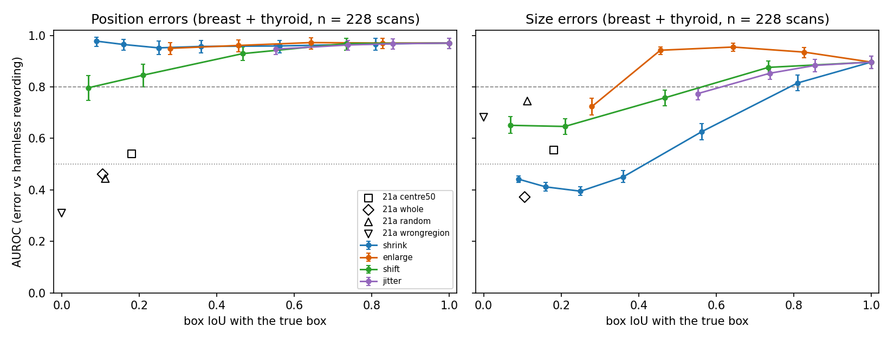

# Step 24 — Box reliability curve for the image check (breast + thyroid, the same 228 test scans as Steps 16 / 19b / 21a)

**Perturbed-prompt sweep, NOT a detector.** Every box starts from the TRUE mask box and is then perturbed (shrink / enlarge about the centre; shift of the centre by a % of box width in a random direction; jitter = independent Gaussian noise on each of the 4 edges, sd = % of box width/height, 3 seeds averaged). MedSAM (`wanglab/medsam-vit-base`, MPS) segments from the perturbed box; the Step 20 tolerance-aware image check (tau = 0.3, position = adjacent, frozen on dev/val) scores every candidate against the facts measured from the predicted mask. Group bootstrap (1,000 resamples, seed 0); † = fewer than 30 groups, too small to compare. AUROC = per case, error candidates vs harmless rewordings, averaged over cases. Code: `usmeta/step24_box_reliability.py`, `usmeta/step24_report.py`.

**Reuse:** exact (Step 16), shrink x0.9 / x0.75 / x0.5 (= 19b shrink 10 / 25 / 50) and enlarge x1.25 (= 19b enlarge 25) are the saved masks; the other 16 settings (x 228 scans) are new MedSAM runs. The 19b shift (10 / 25% of box size) is a different rule from the shift here (% of box width), so shift was re-run in full.
**Levels:** the brief says six levels per family but lists 6 / 4 / 4 / 3 values; only the listed values were run (extra levels would have exceeded the ~3 h limit).

## Headline (breast + thyroid pooled, n = 228 scans)

- **Position AUROC does not fall below 0.80 for shrink, enlarge or jitter at any tested level** (lowest 0.95, at box IoU as low as 0.09), because those perturbations keep the box centre on the lesion and a position claim is read from where the mask sits, not how big the box is. Only the shift family moves the centre: position AUROC is 0.97 / 0.93 / 0.85 / 0.80 at shifts of 10 / 25 / 50 / 75% of box width (box IoU 0.73 / 0.47 / 0.21 / 0.07).
- **IoU at which position AUROC drops below 0.80 / 0.60:** below 0.80 at box IoU ≈ 0.08 on the shift curve (0.14 on the pooled fine-bin curve, which mixes families); below 0.60 **never reached by any perturbation of the true box** (lowest point 0.80, shifted by 0.75 widths, breast 0.79, thyroid 0.81; the pooled fine-bin value 0.04 rests on very few shifted instances at the lowest IoU). Box IoU is therefore a poor single axis for position: the centre offset table below is the cleaner one (≥ 0.91 up to a centre offset of 0.5 widths, ≈ 0.80 at 0.5–0.75, ≈ 0.78 at 0.75–1.5 widths).
- **The label-free boxes of Step 21a sit at box IoU 0.18 (centre), 0.11 (whole image), 0.11 (random), 0.00 (wrong region)** and give position AUROC 0.54 / 0.46 / 0.44 / 0.31 under this step's rule, far below the perturbed true boxes at the same IoU (shrink x0.3 at IoU 0.09: 0.98). Same IoU, different position AUROC: what matters is whether the box is centred on the lesion, which a label-free prompt cannot guarantee.
- **Size claims degrade much earlier and follow the box scale.** Size AUROC drops below 0.80 at box IoU ≈ 0.60 (pooled fine bins), 0.79 (shrink), 0.61 (jitter), 0.56 (shift), and below 0.60 at ≈ 0.36 (pooled) / 0.53 (shrink). With the box shrunk to x0.5 or less the size AUROC is 0.39 or lower, below chance.
- **Mechanical part of the size drop:** the 'size just follows the box' column (true-mask facts, size scaled by the box scale, no segmentation) is 0.33 at shrink x0.5 and 0.34 at x0.3, against MedSAM 0.39 / 0.44: the below-chance size result for small boxes is mechanical (the stated true size is judged against the box). At mild shrink (x0.9) the box-only value is 1.00 but MedSAM gives 0.82, so about 0.18 of AUROC there is segmentation error rather than box scale (MedSAM's mask is already 16% smaller than the true size with the exact box). That under-sizing is also why size AUROC is highest for slightly enlarged boxes (0.95 at x1.25 against 0.90 for the exact box): the check is partly calibrated to MedSAM's habit of undersizing, not evidence of better localisation. Shift and jitter lower size AUROC without changing the box scale on average, i.e. through segmentation error from a misplaced box.
- **False alarms:** the correct-report score falls from 0.937 (exact box) to 0.765 (shrink x0.5), 0.794 (shift 0.75), 0.883 (jitter 20%), and stays at 0.959 for enlarge x1.5.
- **Caveats:** all boxes are derived from the TRUE mask, so this is a sensitivity curve, not a detector test; box IoU is computed against the true-mask box; for TN5000 the 'true' mask is itself a box; the IoU-bin table mixes families; bootstrap CIs are over scans' groups (206 groups pooled; breast 120, thyroid 86; every cell here has at least 86 groups).

## Pooled by family and level (n = 228 scans, 206 groups)

| family | level | mean box IoU | mean mask IoU | position AUROC | size AUROC | all-checkable AUROC | correct-report score | size AUROC if size just follows the box (no MedSAM) | median MedSAM size / true size |
|---|---|---|---|---|---|---|---|---|---|
| exact | 1.0 | 1.00 | 0.65 | 0.97 (0.95–0.99) | 0.90 (0.87–0.92) | 0.93 (0.92–0.95) | 0.937 | 0.99 (0.99–1.00) | 0.84 |
| shrink | 0.3 | 0.09 | 0.10 | 0.98 (0.96–0.99) | 0.44 (0.43–0.45) | 0.72 (0.71–0.73) | 0.756 | 0.34 (0.34–0.35) | 0.26 |
| shrink | 0.4 | 0.16 | 0.14 | 0.96 (0.94–0.98) | 0.41 (0.40–0.43) | 0.70 (0.69–0.71) | 0.759 | 0.33 (0.33–0.33) | 0.33 |
| shrink | 0.5 | 0.25 | 0.20 | 0.95 (0.92–0.98) | 0.39 (0.38–0.41) | 0.69 (0.68–0.71) | 0.765 | 0.33 (0.33–0.33) | 0.40 |
| shrink | 0.6 | 0.36 | 0.28 | 0.96 (0.93–0.98) | 0.45 (0.43–0.48) | 0.72 (0.71–0.74) | 0.789 | 0.66 (0.66–0.67) | 0.48 |
| shrink | 0.75 | 0.56 | 0.43 | 0.96 (0.93–0.98) | 0.63 (0.59–0.66) | 0.81 (0.79–0.82) | 0.851 | 0.81 (0.80–0.83) | 0.63 |
| shrink | 0.9 | 0.81 | 0.58 | 0.97 (0.94–0.99) | 0.82 (0.79–0.85) | 0.89 (0.88–0.91) | 0.914 | 1.00 (0.99–1.00) | 0.77 |
| enlarge | 1.1 | 0.83 | 0.69 | 0.97 (0.95–0.99) | 0.93 (0.91–0.95) | 0.95 (0.94–0.96) | 0.950 | 0.98 (0.97–0.99) | 0.90 |
| enlarge | 1.25 | 0.64 | 0.71 | 0.97 (0.95–0.99) | 0.95 (0.94–0.97) | 0.96 (0.95–0.97) | 0.956 | 0.82 (0.81–0.83) | 0.96 |
| enlarge | 1.5 | 0.46 | 0.70 | 0.96 (0.94–0.98) | 0.94 (0.93–0.96) | 0.95 (0.94–0.96) | 0.959 | 0.52 (0.51–0.53) | 1.05 |
| enlarge | 2.0 | 0.28 | 0.53 | 0.95 (0.92–0.97) | 0.72 (0.69–0.76) | 0.84 (0.82–0.86) | 0.936 | 0.33 (0.33–0.34) | 1.28 |
| shift | 0.1 | 0.73 | 0.61 | 0.97 (0.94–0.99) | 0.88 (0.85–0.90) | 0.92 (0.91–0.93) | 0.934 | 0.99 (0.99–1.00) | 0.83 |
| shift | 0.25 | 0.47 | 0.42 | 0.93 (0.90–0.96) | 0.76 (0.73–0.79) | 0.86 (0.84–0.88) | 0.891 | 0.99 (0.98–1.00) | 0.73 |
| shift | 0.5 | 0.21 | 0.15 | 0.85 (0.80–0.89) | 0.65 (0.62–0.68) | 0.79 (0.77–0.80) | 0.808 | 0.97 (0.96–0.99) | 0.63 |
| shift | 0.75 | 0.07 | 0.03 | 0.80 (0.75–0.84) | 0.65 (0.62–0.68) | 0.78 (0.76–0.80) | 0.794 | 0.91 (0.88–0.93) | 0.67 |
| jitter | 0.05 | 0.86 | 0.64 | 0.97 (0.95–0.99) | 0.88 (0.86–0.91) | 0.93 (0.91–0.94) | 0.933 | 0.99 (0.98–1.00) | 0.84 |
| jitter | 0.1 | 0.74 | 0.60 | 0.96 (0.94–0.98) | 0.85 (0.83–0.88) | 0.91 (0.89–0.92) | 0.920 | 0.98 (0.97–0.98) | 0.81 |
| jitter | 0.2 | 0.55 | 0.51 | 0.95 (0.93–0.96) | 0.77 (0.75–0.79) | 0.86 (0.85–0.87) | 0.883 | 0.90 (0.89–0.92) | 0.76 |
| 21a label-free | centre50 | 0.18 | 0.23 | 0.54 (0.52–0.56) | 0.55 (0.52–0.59) | 0.69 (0.67–0.72) | 0.821 | 0.36 (0.34–0.38) | 1.73 |
| 21a label-free | whole | 0.11 | 0.09 | 0.46 (0.43–0.50) | 0.37 (0.35–0.40) | 0.58 (0.56–0.59) | 0.692 | 0.32 (0.31–0.33) | 3.25 |
| 21a label-free | random | 0.11 | 0.08 | 0.44 (0.38–0.50) | 0.74 (0.71–0.78) | 0.80 (0.78–0.82) | 0.782 | 0.99 (0.99–1.00) | 0.70 |
| 21a label-free | wrongregion | 0.00 | 0.00 | 0.31 (0.26–0.37) | 0.68 (0.65–0.71) | 0.75 (0.73–0.77) | 0.717 | 0.94 (0.92–0.96) | 0.65 |

## Breast by family and level (n = 138 scans, 120 groups)

| family | level | mean box IoU | mean mask IoU | position AUROC | size AUROC | all-checkable AUROC | correct-report score | size AUROC if size just follows the box (no MedSAM) | median MedSAM size / true size |
|---|---|---|---|---|---|---|---|---|---|
| exact | 1.0 | 1.00 | 0.71 | 0.98 (0.96–1.00) | 0.94 (0.91–0.96) | 0.96 (0.95–0.97) | 0.969 | 0.99 (0.98–1.00) | 0.88 |
| shrink | 0.3 | 0.09 | 0.10 | 0.98 (0.95–0.99) | 0.43 (0.41–0.44) | 0.72 (0.71–0.73) | 0.776 | 0.34 (0.34–0.35) | 0.27 |
| shrink | 0.4 | 0.16 | 0.14 | 0.97 (0.95–0.99) | 0.39 (0.37–0.40) | 0.71 (0.70–0.72) | 0.781 | 0.33 (0.33–0.33) | 0.33 |
| shrink | 0.5 | 0.25 | 0.21 | 0.96 (0.93–0.99) | 0.37 (0.35–0.39) | 0.70 (0.69–0.71) | 0.788 | 0.33 (0.33–0.33) | 0.42 |
| shrink | 0.6 | 0.36 | 0.30 | 0.97 (0.95–0.99) | 0.44 (0.41–0.47) | 0.73 (0.71–0.75) | 0.809 | 0.66 (0.65–0.67) | 0.50 |
| shrink | 0.75 | 0.56 | 0.47 | 0.97 (0.95–0.99) | 0.66 (0.63–0.70) | 0.83 (0.81–0.85) | 0.884 | 0.81 (0.79–0.83) | 0.65 |
| shrink | 0.9 | 0.81 | 0.64 | 0.98 (0.95–0.99) | 0.87 (0.83–0.90) | 0.93 (0.91–0.94) | 0.950 | 0.99 (0.98–1.00) | 0.81 |
| enlarge | 1.1 | 0.83 | 0.74 | 0.98 (0.96–1.00) | 0.96 (0.95–0.98) | 0.97 (0.96–0.98) | 0.976 | 0.98 (0.96–0.99) | 0.93 |
| enlarge | 1.25 | 0.65 | 0.75 | 0.98 (0.95–0.99) | 0.96 (0.95–0.98) | 0.97 (0.96–0.98) | 0.979 | 0.82 (0.81–0.83) | 1.00 |
| enlarge | 1.5 | 0.46 | 0.73 | 0.98 (0.96–1.00) | 0.94 (0.92–0.96) | 0.96 (0.95–0.97) | 0.980 | 0.52 (0.50–0.54) | 1.06 |
| enlarge | 2.0 | 0.28 | 0.57 | 0.96 (0.94–0.99) | 0.74 (0.70–0.78) | 0.86 (0.84–0.88) | 0.956 | 0.34 (0.33–0.34) | 1.23 |
| shift | 0.1 | 0.73 | 0.66 | 0.98 (0.96–1.00) | 0.91 (0.88–0.93) | 0.95 (0.93–0.96) | 0.964 | 0.99 (0.98–1.00) | 0.86 |
| shift | 0.25 | 0.46 | 0.45 | 0.96 (0.93–0.99) | 0.78 (0.75–0.82) | 0.88 (0.86–0.90) | 0.919 | 0.99 (0.97–1.00) | 0.75 |
| shift | 0.5 | 0.20 | 0.15 | 0.88 (0.84–0.93) | 0.64 (0.60–0.68) | 0.80 (0.78–0.82) | 0.829 | 0.97 (0.95–0.99) | 0.63 |
| shift | 0.75 | 0.06 | 0.02 | 0.79 (0.72–0.86) | 0.62 (0.58–0.66) | 0.78 (0.75–0.80) | 0.804 | 0.91 (0.88–0.94) | 0.66 |
| jitter | 0.05 | 0.85 | 0.69 | 0.98 (0.96–0.99) | 0.92 (0.90–0.94) | 0.95 (0.94–0.96) | 0.964 | 0.99 (0.98–1.00) | 0.87 |
| jitter | 0.1 | 0.74 | 0.66 | 0.98 (0.96–0.99) | 0.89 (0.86–0.92) | 0.93 (0.92–0.95) | 0.956 | 0.97 (0.96–0.98) | 0.85 |
| jitter | 0.2 | 0.56 | 0.56 | 0.96 (0.94–0.98) | 0.79 (0.77–0.82) | 0.88 (0.87–0.90) | 0.916 | 0.90 (0.89–0.92) | 0.78 |
| 21a label-free | centre50 | 0.19 | 0.27 | 0.56 (0.52–0.60) | 0.58 (0.53–0.63) | 0.71 (0.68–0.74) | 0.848 | 0.37 (0.34–0.39) | 1.56 |
| 21a label-free | whole | 0.11 | 0.09 | 0.45 (0.40–0.49) | 0.38 (0.35–0.42) | 0.58 (0.56–0.60) | 0.705 | 0.32 (0.30–0.33) | 2.95 |
| 21a label-free | random | 0.12 | 0.10 | 0.44 (0.37–0.52) | 0.72 (0.68–0.76) | 0.80 (0.77–0.82) | 0.794 | 0.99 (0.98–1.00) | 0.69 |
| 21a label-free | wrongregion | 0.00 | 0.00 | 0.33 (0.26–0.41) | 0.68 (0.63–0.71) | 0.77 (0.74–0.79) | 0.748 | 0.94 (0.91–0.97) | 0.65 |

## Thyroid by family and level (n = 90 scans, 86 groups)

| family | level | mean box IoU | mean mask IoU | position AUROC | size AUROC | all-checkable AUROC | correct-report score | size AUROC if size just follows the box (no MedSAM) | median MedSAM size / true size |
|---|---|---|---|---|---|---|---|---|---|
| exact | 1.0 | 1.00 | 0.56 | 0.95 (0.90–0.99) | 0.84 (0.79–0.87) | 0.89 (0.87–0.92) | 0.887 | 1.00 (0.99–1.00) | 0.79 |
| shrink | 0.3 | 0.09 | 0.10 | 0.98 (0.95–1.00) | 0.46 (0.44–0.48) | 0.71 (0.70–0.73) | 0.726 | 0.34 (0.34–0.35) | 0.26 |
| shrink | 0.4 | 0.16 | 0.14 | 0.95 (0.91–0.99) | 0.45 (0.42–0.48) | 0.70 (0.68–0.72) | 0.725 | 0.33 (0.33–0.33) | 0.32 |
| shrink | 0.5 | 0.25 | 0.18 | 0.94 (0.88–0.98) | 0.43 (0.40–0.47) | 0.68 (0.66–0.71) | 0.729 | 0.33 (0.33–0.33) | 0.39 |
| shrink | 0.6 | 0.36 | 0.24 | 0.93 (0.88–0.97) | 0.46 (0.43–0.50) | 0.71 (0.68–0.73) | 0.758 | 0.67 (0.67–0.67) | 0.44 |
| shrink | 0.75 | 0.56 | 0.36 | 0.94 (0.88–0.98) | 0.57 (0.52–0.62) | 0.77 (0.74–0.79) | 0.801 | 0.82 (0.79–0.84) | 0.57 |
| shrink | 0.9 | 0.81 | 0.49 | 0.95 (0.90–0.99) | 0.73 (0.68–0.78) | 0.84 (0.81–0.87) | 0.858 | 1.00 (1.00–1.00) | 0.70 |
| enlarge | 1.1 | 0.83 | 0.60 | 0.95 (0.90–0.99) | 0.89 (0.84–0.93) | 0.92 (0.89–0.94) | 0.909 | 0.99 (0.98–1.00) | 0.85 |
| enlarge | 1.25 | 0.64 | 0.63 | 0.96 (0.92–1.00) | 0.94 (0.91–0.97) | 0.94 (0.92–0.96) | 0.920 | 0.82 (0.81–0.83) | 0.91 |
| enlarge | 1.5 | 0.45 | 0.64 | 0.93 (0.87–0.97) | 0.95 (0.93–0.97) | 0.94 (0.92–0.96) | 0.927 | 0.51 (0.50–0.53) | 1.00 |
| enlarge | 2.0 | 0.27 | 0.47 | 0.93 (0.88–0.96) | 0.69 (0.64–0.75) | 0.82 (0.79–0.84) | 0.904 | 0.33 (0.33–0.33) | 1.36 |
| shift | 0.1 | 0.74 | 0.52 | 0.94 (0.89–0.98) | 0.83 (0.78–0.87) | 0.89 (0.86–0.91) | 0.888 | 1.00 (0.99–1.00) | 0.77 |
| shift | 0.25 | 0.49 | 0.36 | 0.88 (0.82–0.93) | 0.72 (0.67–0.77) | 0.83 (0.80–0.85) | 0.849 | 1.00 (1.00–1.00) | 0.70 |
| shift | 0.5 | 0.23 | 0.14 | 0.78 (0.69–0.86) | 0.66 (0.61–0.70) | 0.77 (0.74–0.80) | 0.776 | 0.98 (0.96–1.00) | 0.64 |
| shift | 0.75 | 0.08 | 0.04 | 0.81 (0.74–0.88) | 0.69 (0.64–0.74) | 0.79 (0.76–0.82) | 0.778 | 0.90 (0.86–0.95) | 0.70 |
| jitter | 0.05 | 0.86 | 0.55 | 0.95 (0.89–0.98) | 0.83 (0.79–0.87) | 0.89 (0.86–0.91) | 0.887 | 1.00 (0.99–1.00) | 0.80 |
| jitter | 0.1 | 0.74 | 0.51 | 0.94 (0.89–0.98) | 0.80 (0.76–0.83) | 0.86 (0.84–0.89) | 0.864 | 0.99 (0.98–0.99) | 0.75 |
| jitter | 0.2 | 0.54 | 0.43 | 0.92 (0.87–0.95) | 0.74 (0.70–0.78) | 0.83 (0.80–0.85) | 0.833 | 0.90 (0.88–0.92) | 0.72 |
| 21a label-free | centre50 | 0.17 | 0.18 | 0.51 (0.50–0.54) | 0.52 (0.45–0.58) | 0.67 (0.64–0.71) | 0.781 | 0.36 (0.33–0.39) | 2.05 |
| 21a label-free | whole | 0.10 | 0.08 | 0.48 (0.42–0.54) | 0.36 (0.33–0.39) | 0.57 (0.55–0.60) | 0.672 | 0.32 (0.30–0.33) | 3.81 |
| 21a label-free | random | 0.10 | 0.06 | 0.45 (0.34–0.56) | 0.78 (0.74–0.82) | 0.80 (0.77–0.83) | 0.764 | 1.00 (0.99–1.00) | 0.74 |
| 21a label-free | wrongregion | 0.00 | 0.00 | 0.27 (0.20–0.34) | 0.69 (0.64–0.74) | 0.73 (0.69–0.76) | 0.669 | 0.94 (0.90–0.98) | 0.66 |

## By box-IoU bin (every perturbed instance, all families pooled; the exact box sits in 0.9–1.0)

| organ | box IoU | instances | scans | groups | mean mask IoU | position AUROC | size AUROC | all-checkable AUROC | correct-report score |
|---|---|---|---|---|---|---|---|---|---|
| pooled | 0.9-1.0 | 380 | 228 | 206 | 0.64 | 0.97 (0.95–0.99) | 0.89 (0.86–0.91) | 0.93 (0.91–0.94) | 0.935 |
| pooled | 0.7-0.9 | 1765 | 228 | 206 | 0.63 | 0.97 (0.95–0.99) | 0.88 (0.85–0.90) | 0.92 (0.91–0.93) | 0.930 |
| pooled | 0.5-0.7 | 1167 | 228 | 206 | 0.56 | 0.96 (0.94–0.98) | 0.81 (0.79–0.83) | 0.89 (0.87–0.90) | 0.906 |
| pooled | 0.3-0.5 | 934 | 228 | 206 | 0.43 | 0.93 (0.90–0.95) | 0.71 (0.69–0.73) | 0.83 (0.82–0.84) | 0.869 |
| pooled | <0.3 | 2138 | 228 | 206 | 0.13 | 0.72 (0.71–0.74) | 0.54 (0.53–0.55) | 0.73 (0.72–0.73) | 0.775 |
| breast | 0.9-1.0 | 228 | 138 | 120 | 0.69 | 0.99 (0.97–1.00) | 0.92 (0.90–0.95) | 0.95 (0.94–0.97) | 0.966 |
| breast | 0.7-0.9 | 1070 | 138 | 120 | 0.69 | 0.98 (0.96–0.99) | 0.91 (0.89–0.93) | 0.95 (0.93–0.96) | 0.963 |
| breast | 0.5-0.7 | 712 | 138 | 120 | 0.61 | 0.97 (0.95–0.99) | 0.83 (0.81–0.86) | 0.91 (0.89–0.92) | 0.935 |
| breast | 0.3-0.5 | 568 | 138 | 120 | 0.46 | 0.95 (0.92–0.97) | 0.71 (0.69–0.73) | 0.84 (0.83–0.85) | 0.890 |
| breast | <0.3 | 1286 | 138 | 120 | 0.14 | 0.73 (0.71–0.75) | 0.54 (0.52–0.55) | 0.73 (0.73–0.74) | 0.796 |
| thyroid | 0.9-1.0 | 152 | 90 | 86 | 0.55 | 0.94 (0.87–0.99) | 0.83 (0.78–0.88) | 0.89 (0.86–0.91) | 0.889 |
| thyroid | 0.7-0.9 | 695 | 90 | 86 | 0.54 | 0.95 (0.91–0.98) | 0.82 (0.78–0.86) | 0.88 (0.86–0.91) | 0.880 |
| thyroid | 0.5-0.7 | 455 | 90 | 86 | 0.48 | 0.94 (0.89–0.97) | 0.77 (0.74–0.80) | 0.85 (0.83–0.87) | 0.859 |
| thyroid | 0.3-0.5 | 366 | 90 | 86 | 0.39 | 0.89 (0.84–0.94) | 0.71 (0.69–0.74) | 0.82 (0.80–0.84) | 0.837 |
| thyroid | <0.3 | 852 | 90 | 86 | 0.12 | 0.71 (0.68–0.74) | 0.55 (0.53–0.58) | 0.71 (0.70–0.73) | 0.742 |

Bins mix families, so a bin can contain different perturbation types; the per-family tables above are the cleaner view.

## Where does position AUROC fall below 0.80 and 0.60? (box IoU; pooled breast + thyroid)

| curve | metric | below 0.80 at box IoU ≈ | below 0.60 at box IoU ≈ |
|---|---|---|---|
| pooled fine bins | position | 0.14 | 0.04 |
| pooled fine bins | size | 0.60 | 0.36 |
| shrink | position | not crossed | not crossed |
| shrink | size | 0.79 | 0.53 |
| enlarge | position | not crossed | not crossed |
| enlarge | size | 0.34 | not crossed |
| shift | position | 0.08 | not crossed |
| shift | size | 0.56 | not crossed |
| jitter | position | not crossed | not crossed |
| jitter | size | 0.61 | not crossed |

Linear interpolation between the measured points (fine bins: 0.1-wide box-IoU bins with ≥ 30 instances); "not crossed" = the curve never drops below the line within the tested range.

## Size versus position (what is mechanical)

Size claims are checked against a length measured from the MedSAM mask, and MedSAM follows the box it is given: when the box is scaled by s the mask size scales by about s, so a report that states the TRUE size is read as a size error of about 1/s. The "size AUROC if size just follows the box" column is the check with no segmentation at all (true-mask facts, linear size multiplied by the box scale); the "median MedSAM size / true size" column shows how closely the mask follows the box. Where the MedSAM size AUROC and the box-only column move together, the drop is mechanical (the stated size is judged against the box, not the lesion). Position claims are different: they depend on where the mask lands, which depends on the box centre, not on its scale. Shrink and enlarge change size without moving the centre, so they hit size claims first and position claims late; shift and jitter move the centre, so they hit position first.

## Label-free boxes from Step 21a on the same axes

The Step 21a masks (not re-run) scored with this step's rule (Step 20 tolerance, adjacent position) so they can be placed on the curve; the 21a column is the exact-match rule used in that step.

| 21a prompt | mean box IoU with the true box | position AUROC (this step's rule) | size AUROC (this step's rule) | position AUROC (21a, exact-match) | size AUROC (21a, exact-match) |
|---|---|---|---|---|---|
| centre50 | 0.18 | 0.54 (0.52–0.56) | 0.55 (0.52–0.59) | 0.54 (0.52–0.57) | 0.53 (0.49–0.58) |
| whole | 0.11 | 0.46 (0.43–0.50) | 0.37 (0.35–0.40) | 0.47 (0.44–0.49) | 0.41 (0.39–0.44) |
| random | 0.11 | 0.44 (0.38–0.50) | 0.74 (0.71–0.78) | 0.47 (0.43–0.51) | 0.67 (0.63–0.71) |
| wrongregion | 0.00 | 0.31 (0.26–0.37) | 0.68 (0.65–0.71) | 0.39 (0.35–0.43) | 0.58 (0.55–0.62) |

## Position AUROC by distance between box centre and true-box centre (all perturbed instances, pooled)

| centre offset (true-box widths) | instances | groups | mean box IoU | position AUROC | size AUROC |
|---|---|---|---|---|---|
| <0.1 | 3973 | 206 | 0.61 | 0.97 (0.95–0.98) | 0.76 (0.74–0.77) |
| 0.1-0.25 | 810 | 205 | 0.58 | 0.95 (0.92–0.97) | 0.79 (0.77–0.81) |
| 0.25-0.5 | 360 | 188 | 0.36 | 0.91 (0.88–0.94) | 0.70 (0.67–0.73) |
| 0.5-0.75 | 240 | 163 | 0.13 | 0.80 (0.75–0.86) | 0.64 (0.61–0.68) |
| 0.75-1.5 | 89 | 88 | 0.06 | 0.78 (0.71–0.84) | 0.69 (0.64–0.73) |

Bins use all four families; shrink / enlarge keep the centre, so they sit in the first row.

Files: `curve.csv` (level and IoU-bin tables, all organs), `curve.png`, `case_rows.json` (one row per scan x condition), `predict.log`, `run_info.json`.
