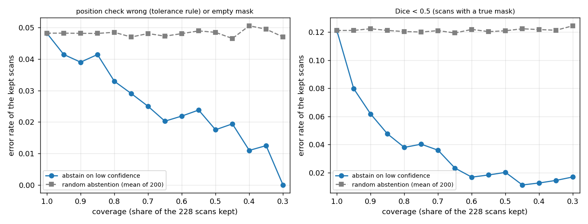

# Step 38: responsible-AI checks on the Step 29 image check

Limitations: [docs/LIMITATIONS.md](../../../docs/LIMITATIONS.md). Code: `usmeta/step38_responsible_ai.py`, `step38_report.py` (new files). **Nothing was retrained and no new `splits.load('test')` call was made:** the saved Step 29 U-Net models, saved test masks and saved per-scan results are reused for the 228 test scans (Steps 21a / 24 / 29, whose test reads were logged); part (b) and (c) run the saved models on those scans' images. Same Step 20 tolerance-aware rule (tau 0.3, adjacent position), same group bootstrap (1,000, seed 0), cells under 30 groups marked † (too small to compare).

## Headline

- **(a) The image check is not equally good on every source dataset.** Position AUROC per dataset (30 scans each, every cell under 30 groups: too small to compare, shown for orientation): BrEaST 0.91, BUS-BRA 1.00, BUSI 0.84, UDIAT 1.00, BUS-UCLM 0.94, TN3K 0.93, TN5000 0.69, DDTI 0.77; the weakest are TN5000 (the only dataset with no training images: 0.69), DDTI (0.77) and BUSI (0.84); Dice is lowest on BrEaST (0.67), DDTI (0.68) and BUSI (0.69). **Scanner / device identity exists in the files of one dataset only (BUS-BRA, 4 device codes); no other dataset has a scanner or acquisition-protocol field, so scanner effects cannot be examined elsewhere** (nothing was inferred or guessed).
- **(b) Abstaining on low U-Net confidence helps: modestly for the position check, strongly for mask failure.** Keeping the 80% most confident scans (per organ) lowers the position-check error from 4.8% to 3.3% and raises position AUROC from 0.89 to 0.93; at 60% coverage the error is 2.2% and AUROC 0.94; random abstention leaves both unchanged (4.8% and 0.89). The val-chosen thresholds give 80% and 58% test coverage. The gain on position error is small in absolute terms because only 11 of 228 scans have a wrong position at all; abstention works much better against mask failure (Dice < 0.5): 12.1% of the scans with a true mask fail, 3.8% at 80% coverage and 1.7% at 60%, against a flat random-abstention baseline.
- **(c) The check is robust to these corruptions: no setting lowers pooled position AUROC by more than 0.05.** Clean position AUROC 0.89 and Dice 0.77; the largest drops are the strongest brightness / gamma shift (0.84, Dice 0.70) and the strongest noise (0.85, Dice 0.73); blur (radius 4 px: AUROC 0.89, Dice 0.73) and JPEG quality 5 (0.87) change the AUROC by 0.02 or less, although blur lowers Dice. All differences are inside the group-bootstrap intervals (which are wide because the same 228 scans are used in every row). Thyroid is the more sensitive organ (clean 0.80, strongest gamma 0.72).

## (a) Per-dataset gap table (Step 29 U-Net, 228 test scans; saved results)

Position AUROC and correct-report score: Step 20 tolerance-aware check (AUROC of planted errors vs harmless rewordings; correct-report score = mean score of the identical copies). Dice only for scans with a true mask (TN5000 has boxes only: no Dice). Detection = share of non-empty masks. 95% group bootstrap; † = under 30 groups.

| source | scans | detection rate | Dice | position AUROC | correct-report score | groups (position) |
|---|---|---|---|---|---|---|
| BrEaST (breast) | 30 | 0.97 (0.90–1.00) | 0.67 (0.56–0.78) | 0.91 (0.82–1.00) † | 0.90 (0.82–0.96) | 17 |
| BUS-BRA (breast) | 30 | 1.00 (1.00–1.00) † | 0.87 (0.83–0.91) † | 1.00 (1.00–1.00) † | 0.96 (0.92–0.99) † | 14 |
| BUSI (breast) | 30 | 0.97 (0.90–1.00) | 0.69 (0.57–0.79) | 0.84 (0.74–0.95) † | 0.93 (0.85–0.98) | 19 |
| UDIAT (breast) | 30 | 1.00 (1.00–1.00) | 0.87 (0.83–0.90) | 1.00 (1.00–1.00) † | 0.98 (0.96–1.00) | 23 |
| BUS-UCLM (breast) | 18 | 1.00 (1.00–1.00) † | 0.84 (0.75–0.92) † | 0.94 (0.75–1.00) † | 0.95 (0.92–0.99) † | 3 |
| TN3K (thyroid) | 30 | 1.00 (1.00–1.00) | 0.82 (0.75–0.88) | 0.93 (0.82–1.00) † | 0.94 (0.90–0.98) | 17 |
| TN5000 (thyroid) | 30 | 1.00 (1.00–1.00) | — | 0.69 (0.50–0.85) † | 0.82 (0.76–0.89) | 17 |
| DDTI (thyroid) | 30 | 1.00 (1.00–1.00) † | 0.68 (0.60–0.75) † | 0.77 (0.57–0.93) † | 0.91 (0.85–0.95) † | 15 |
| **breast (all)** | 138 | 0.99 (0.96–1.00) | 0.78 (0.74–0.82) | 0.94 (0.90–0.97) | 0.94 (0.92–0.97) | 76 |
| **thyroid (all)** | 90 | 1.00 (1.00–1.00) | 0.75 (0.69–0.80) | 0.80 (0.69–0.89) | 0.89 (0.85–0.92) | 49 |
| **pooled** | 228 | 0.99 (0.98–1.00) | 0.77 (0.74–0.81) | 0.89 (0.84–0.93) | 0.92 (0.90–0.94) | 125 |

The Step 29 model was trained on the dev images of all the datasets above except TN5000 (boxes only): TN5000 is the one cross-dataset row, and it is the lowest on position AUROC and correct-report score. Dataset gaps are not separable from lesion mix, image size and the number of training images per dataset.

### Scanner / acquisition metadata that exists in the dataset files (column names and counts only; no licensed text copied)

- **BUS-BRA:** bus_data.csv has a `Device` column with 4 distinct values over 1875 images (counts [902, 809, 139, 25]); used below as anonymised codes D1-D4 (names not copied)
- **BrEaST:** clinical spreadsheet has `Pixel_size` (acquisition resolution) but no device / scanner column
- **UDIAT:** DatasetB.xlsx: Image, Type, Diagnosis, legend columns only; no scanner field
- **BUS-UCLM:** INFO.csv: Image;Resolution;Label (image resolution only); no scanner field
- **BUSI:** no table of metadata in the folder
- **TN3K:** no metadata table
- **TN5000:** Pascal-VOC XML (filename, size, bounding box; generic folder / database / owner fields); no scanner field
- **DDTI:** XML with age, sex, TI-RADS, composition, echogenicity, margins, calcifications; no scanner field
- **HC18:** CSV with pixel size (mm) and head circumference only

**Scanner / device identity exists in the files of ONE dataset (BUS-BRA); all other datasets have no scanner or acquisition-protocol field (BrEaST, BUS-UCLM, HC18 give pixel size / resolution only). No scanner was inferred for any other dataset.**

BUS-BRA by anonymised scanner code (codes D1-D4 by image count in the whole dataset: D1 902, D2 809, D3 139, D4 25; the codes are not device names and cannot be mapped back from this file). Test scans in this sample:

| scanner code | scans | Dice | position AUROC | correct-report score |
|---|---|---|---|---|
| D1 | 17 | 0.84 (0.78–0.89) † | 1.00 (1.00–1.00) † | 0.98 (0.96–1.00) † |
| D2 | 11 | 0.90 (0.83–0.95) † | 1.00 (1.00–1.00) † | 0.96 (0.88–1.00) † |
| D4 | 2 | 0.93 (0.93–0.93) † | 1.00 (1.00–1.00) † | 0.80 (0.80–0.80) † |

Each scanner cell has 2-17 scans (under 30 groups): **too small to compare**; D3 has no scan in this sample. No scanner difference can be claimed from this table.

## (b) Risk-coverage: abstain when the mask is empty or its mean foreground probability is low

**Confidence** = mean probability of the pixels the model calls foreground (probability above the model's own threshold, at its 256 x 256 resolution); an empty mask has confidence 0 and always abstains. **Threshold chosen on VAL only:** the 20th and 40th percentile of the confidence of all val images with a mask, per organ model (breast 0.936 / 0.961, thyroid 0.875 / 0.910), i.e. the thresholds that would keep 80% and 60% of val scans; they are applied unchanged to the test scans. **Error** = the position check fails: the predicted position (3 x 3 grid) of the lesion is neither the true cell nor an adjacent one (tolerance rule), or the mask is empty.

| operating point | scans kept (coverage) | position error rate (95% CI) | position AUROC (95% CI) | mean Dice of kept scans |
|---|---|---|---|---|
| 100% (no abstention) | 228 (100%) | 4.8% (2.2–8.1) | 0.89 (0.84–0.93) | 0.77 |
| val-chosen threshold for 80% val coverage | 183 (80%) | 3.3% (1.1–6.0) | 0.93 (0.88–0.97) | 0.84 |
| val-chosen threshold for 60% val coverage | 133 (58%) | 2.3% (0.0–5.3) | 0.93 (0.88–0.98) | 0.87 |

**Exact coverage by rank** (per organ the most confident 100%, 80%, 60% of the test scans are kept; no threshold, to give the three requested coverage points), with random abstention of the same size as the baseline (mean of 300 draws):

| coverage | scans | position error | random-abstention error | position AUROC (95% CI) | random-abstention AUROC |
|---|---|---|---|---|---|
| 100% | 228 | 4.8% (2.2–7.9) | 4.8% | 0.89 (0.84–0.93) | 0.89 |
| 80% | 182 | 3.3% (1.1–6.1) | 4.8% | 0.93 (0.87–0.97) | 0.89 |
| 60% | 137 | 2.2% (0.0–5.1) | 4.8% | 0.94 (0.89–0.98) | 0.89 |

Second error definition, mask failure (Dice < 0.5, 198 scans with a true mask): overall error 12.1%; at 80% coverage 3.8%, at 60% 1.7% (random abstention stays at 12.1%). Full curves in `b_results.json`; plot: `risk_coverage.png` (both error definitions, with the random-abstention baseline).

## (c) Robustness to image corruptions (228 test scans; position check re-run on the model's mask of the corrupted image)

Corruptions on the grayscale image the model sees: Gaussian noise (sigma 10 / 25 / 50 grey levels), Gaussian blur (radius 1 / 2 / 4 px), JPEG re-compression (quality 50 / 20 / 5), brightness and gamma shift (gamma 0.85 with +10, gamma 0.70 with +25, gamma 0.55 with +45 grey levels: darker tones lifted, brighter overall). Deterministic (noise seeded per scan). Position AUROC and correct-report score as in Step 29; the clean row is recomputed in this run with the same code (it reproduces the saved Step 29 numbers).

| corruption | strength | detection | Dice (pooled) | position AUROC pooled (95% CI) | breast | thyroid | correct-report score | change in position AUROC vs clean |
|---|---|---|---|---|---|---|---|---|
| clean | clean | 0.99 (0.98–1.00) | 0.77 (0.74–0.81) | 0.89 (0.84–0.93) | 0.94 (0.90–0.97) | 0.80 (0.69–0.89) | 0.92 (0.90–0.94) | +0.00 |
| noise | sigma 10 | 0.99 (0.97–1.00) | 0.77 (0.73–0.81) | 0.89 (0.84–0.93) | 0.94 (0.90–0.97) | 0.80 (0.69–0.89) | 0.92 (0.90–0.94) | +0.00 |
| noise | sigma 25 | 0.99 (0.97–1.00) | 0.76 (0.72–0.79) | 0.88 (0.83–0.92) | 0.93 (0.90–0.97) | 0.79 (0.68–0.88) | 0.92 (0.90–0.94) | -0.01 |
| noise | sigma 50 | 0.98 (0.96–1.00) | 0.73 (0.69–0.76) | 0.85 (0.81–0.90) | 0.91 (0.87–0.95) | 0.75 (0.65–0.85) | 0.90 (0.87–0.92) | -0.03 |
| blur | radius 1 px | 0.99 (0.97–1.00) | 0.77 (0.74–0.81) | 0.88 (0.84–0.92) | 0.94 (0.90–0.97) | 0.79 (0.68–0.89) | 0.92 (0.89–0.94) | -0.00 |
| blur | radius 2 px | 0.98 (0.96–1.00) | 0.76 (0.72–0.79) | 0.89 (0.84–0.92) | 0.93 (0.90–0.97) | 0.81 (0.71–0.90) | 0.90 (0.88–0.93) | +0.00 |
| blur | radius 4 px | 1.00 (0.99–1.00) | 0.73 (0.68–0.77) | 0.89 (0.85–0.93) | 0.93 (0.88–0.96) | 0.83 (0.75–0.91) | 0.91 (0.89–0.93) | +0.01 |
| jpeg | quality 50 | 0.99 (0.98–1.00) | 0.77 (0.74–0.81) | 0.89 (0.85–0.93) | 0.94 (0.90–0.97) | 0.81 (0.70–0.90) | 0.92 (0.90–0.94) | +0.00 |
| jpeg | quality 20 | 0.99 (0.97–1.00) | 0.77 (0.74–0.81) | 0.89 (0.84–0.93) | 0.94 (0.90–0.97) | 0.80 (0.69–0.89) | 0.92 (0.90–0.94) | +0.00 |
| jpeg | quality 5 | 0.98 (0.96–1.00) | 0.75 (0.72–0.79) | 0.87 (0.83–0.91) | 0.92 (0.88–0.96) | 0.79 (0.69–0.88) | 0.90 (0.88–0.93) | -0.01 |
| brightness_gamma | gamma 0.85, +10 | 0.98 (0.96–1.00) | 0.77 (0.74–0.81) | 0.88 (0.84–0.93) | 0.93 (0.90–0.97) | 0.80 (0.69–0.89) | 0.91 (0.88–0.93) | -0.00 |
| brightness_gamma | gamma 0.70, +25 | 0.99 (0.98–1.00) | 0.77 (0.73–0.80) | 0.89 (0.85–0.93) | 0.95 (0.91–0.98) | 0.80 (0.70–0.90) | 0.91 (0.89–0.93) | +0.01 |
| brightness_gamma | gamma 0.55, +45 | 0.98 (0.96–1.00) | 0.70 (0.66–0.73) | 0.84 (0.79–0.88) | 0.90 (0.86–0.94) | 0.72 (0.62–0.82) | 0.89 (0.86–0.91) | -0.05 |

Pooled rows have 207 groups (all intervals shown are over groups; the 228 scans are the same in every row, so the rows are strongly dependent); per-organ cells have 120 and 87 groups. Size and all-checkable AUROC for every setting are in `c_results.json`.

## Caveats

- **Same 228 scans, one model, one seed** (the Step 29 U-Net, trained on dev only, random-init encoder): the per-dataset cells have 30 scans (BUS-UCLM 18) and are too small to compare; the gaps are indications of where to look, not estimates of dataset effects. Dataset, lesion mix, image size and training-set size are confounded.
- **Scanner effect cannot be tested** except inside BUS-BRA (4 device codes, 2-17 test scans each). No scanner or acquisition information was inferred for any other dataset.
- **(b) The position check has few errors** (about 11 of 228 scans under the tolerance rule), so the risk-coverage curve is coarse and its intervals are wide; the confidence is the model's own foreground probability, which is not calibrated. The val thresholds are quantiles of val confidence (no label was used to pick them); the test coverage they give differs from 80% / 60% (see the table).
- **(c) Corruptions are synthetic and mild-to-strong by our choice of strengths**; they are applied to the already-compressed public images, so JPEG quality 50 is a second compression. The model was not trained with these corruptions (it saw flips and brightness / contrast / gamma jitter only). Real acquisition shifts (different scanner, gain, depth) are not covered.
- Templated candidates, as in Step 29: the position check scores claims of templated text against a measurement from the mask.
